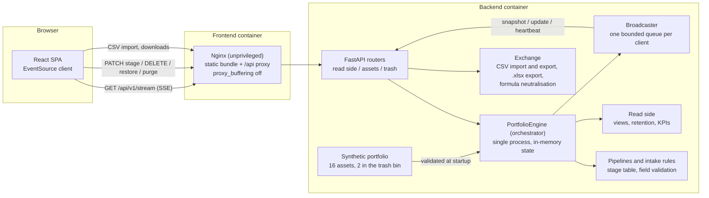

# AssetFlow Multi-Pipeline

[](https://github.com/d-gallardo-1/assetflow-multi-pipeline/actions/workflows/ci.yml)

**A multi-pipeline Kanban and asset lifecycle control system for capital projects: live board synchronisation, bulk CSV ingestion with validation, a soft-delete trash bin with retention, and an executive analytics dashboard.**

<!-- TODO: Insert 15s demo GIF here -->

> **Reference demo.** The organisation "Meridian Capital Assets & Infrastructure Sites — UK
> Operations" is fictional. Every asset, site name, engineer and figure is invented, and
> any resemblance to a real company or facility is coincidental. Regions are real areas
> of the United Kingdom; coordinates are rounded to one decimal and do not locate any
> facility. The application is not connected to any real system.

## The problem

Infrastructure developers and capital project teams follow high-value physical assets
along several operational tracks at once: land being acquired, facilities being built to
order, units being let, audits being delivered. The record of where each asset stands is
usually spread over spreadsheets and email. Nobody sees the whole portfolio, a deleted row
is gone for good, and a bulk update pasted from a spreadsheet can overwrite good data
without anyone noticing.

AssetFlow shows one way to hold that record: one board per track, a server that enforces
the stages, an import that refuses to overwrite, and a delete that can be undone.

## Key features

- **Four pipelines of four ordered stages.**

  | Pipeline | Stages |
  | --- | --- |
  | `LAND_ACQUISITION` Industrial Land & Brownfield Sites | Site Scouting, Technical Due Diligence, Commercial Negotiation, Title Closed |
  | `BUILD_TO_SUIT` Custom Industrial & Logistics Facilities | Engineering Design, Planning & Grid Permits, Civil Execution, Operational Handover |
  | `MULTI_TENANT_PARKS` Industrial Parks & Warehousing | Unit Available, Technical Fit-Out, Lease Contract Review, Active Operation |
  | `ADVISORY_VALUATION` Technical & Environmental Audits | Scope Intake, Field Inspection, Compliance Modelling, Certified Report |

- **Kanban board.** One tab per pipeline and one column per stage. Each card shows the
  asset code, capital value, area, grid capacity, approximate position, permit status and
  risk. Previous and next buttons move the asset, so the board works from the keyboard.
  The server accepts only stages of the asset's own pipeline.
- **Live synchronisation.** Every change is pushed over Server-Sent Events to all
  connected clients. Open two browser tabs and each follows the other.
- **Soft-delete trash bin and audit vault.** Deleting moves an asset to the trash bin
  with its audit trail. It can be restored to its exact pipeline and stage for 30 days
  (configurable), or purged for good after a confirmation.
- **Bulk CSV ingestion.** Upload a file, paste text or run the built-in batch of five
  assets. Valid rows are imported; each invalid row is reported with its row number,
  column and reason. An id that is repeated in the file, already active or in the trash
  bin is a row error, never an overwrite.
- **Executive portfolio analytics.** Capital value by pipeline, funnel across stages,
  total managed area and grid capacity, risk distribution. Active assets only.
- **Workbook export.** Active assets and the summary as `.xlsx`. Text that a spreadsheet
  would run as a formula is neutralised.
- **Audit trail per asset.** Created, moved, deleted and restored, with UTC timestamps.
- **Runs offline.** No CDN, no web fonts, no external API. System font stacks only.
- **Accessible status.** Every badge pairs colour with an icon and a text label, moves
  have descriptive labels, and reduced-motion preferences are respected.

## Architecture



Every SSE event carries one complete portfolio snapshot. A client that connects late, or
reconnects after a drop, is consistent again after a single message.

More detail, including the security posture and what a real deployment would need:
[docs/ARCHITECTURE_AND_SECURITY.md](docs/ARCHITECTURE_AND_SECURITY.md).

## Quickstart

### With Docker

```bash
git clone https://github.com/d-gallardo-1/assetflow-multi-pipeline.git
cd assetflow-multi-pipeline
docker compose up --build
```

Then open <http://127.0.0.1:8083>.

### Without Docker

Requires Python 3.13+ and Node.js 20.19+. Python 3.13 is the version used by the
container image and by CI; the start scripts check it before doing anything else.

```powershell
# Windows. Unsigned scripts are blocked by default, so the policy is relaxed
# for this single run only.
powershell -ExecutionPolicy Bypass -File .\run_local.ps1
```

```bash
# Linux, macOS, WSL
./run_local.sh
```

Then open <http://127.0.0.1:5176>.

### Two-minute tour

1. Open the address in two browser tabs side by side.
2. On **Kanban Board**, press the next-stage button of `AST-401`. The card changes column
   in both tabs. Switch pipeline with the tabs above the columns.
3. Press the delete button of a card. It leaves the board and the KPIs in both tabs.
4. Open **Trash Bin & Audit Vault**. The asset is there with its deletion time, the days
   of retention left and its audit trail. Two seed assets were already waiting. Press
   **Restore to Pipeline** and find the asset back in the column it left.
5. Press **Permanent Purge** on another one and confirm.
6. Open **CSV Ingestion** and press **Simulate Bulk CSV Import (5 Assets)**. Press it
   again: all five rows are now rejected as duplicates, each with its row and reason.
7. Download the sample CSV, break a value (a latitude of `120`, a stage of another
   pipeline), paste it and import it to see the located errors.
8. Open **Portfolio Analytics** and export the workbook. **Reset demo data** on the
   ingestion view starts again.

## UI layout

| Area | Content |
| --- | --- |
| Top bar | Organisation, "synthetic demo data" badge, stream health |
| KPI ribbon | Active assets, capital under management, managed area, grid capacity, trash bin |
| Kanban Board | Pipeline tabs, four stage columns, asset cards with move and delete buttons |
| Portfolio Analytics | Capital by pipeline, funnel across stages, risk distribution, totals, workbook export |
| CSV Ingestion | One-click sample import, file upload, paste area, sample download, validation log |
| Trash Bin & Audit Vault | Deleted assets with deletion time, retention left, audit trail, restore and purge |

## API

Base path: `/api/v1`. The OpenAPI schema is served at `/api/v1/openapi.json`.

| Method | Path | Purpose |
| --- | --- | --- |
| GET | `/health` | Liveness probe |
| GET | `/state` | Active assets grouped by pipeline, trash bin, KPIs |
| GET | `/stream` | Server-Sent Events: `snapshot`, `update`, `heartbeat` |
| POST | `/assets` | Create an asset; the server assigns the id |
| POST | `/assets/reset` | Back to the seed portfolio |
| POST | `/assets/import-csv` | Import CSV sent as the raw body (256 KB, 500 rows) |
| GET | `/assets/sample-csv` | The built-in batch of five assets |
| GET | `/assets/export-xlsx` | Active assets and summary as a workbook |
| PATCH | `/assets/{asset_id}/stage` | Body `{"stage"}`: move within the asset's own pipeline |
| DELETE | `/assets/{asset_id}` | Soft delete into the trash bin |
| POST | `/trash/{asset_id}/restore` | Restore to the exact pipeline and stage |
| DELETE | `/trash/{asset_id}/purge` | Permanent removal, only for assets in the trash bin |

A refused command answers `{"detail": "..."}` with `404` (unknown asset), `409` (wrong
state: moving an asset that is in the trash bin, purging an active one) or `422` (bad
input: a stage of another pipeline). Money is a decimal string, never a float.

```bash
curl -N "http://127.0.0.1:8083/api/v1/stream?max_events=3"
curl -X PATCH -H "Content-Type: application/json" -d '{"stage":"TITLE_CLOSED"}' \
  http://127.0.0.1:8083/api/v1/assets/AST-401/stage
```

### CSV format

Header row first, columns in any order:
`asset_id, name, pipeline, stage, region, area_sqm, capital_value_gbp, lead_engineer, lat, lon, grid_capacity_mva, permits_verified, risk_level`.

- A missing, unknown or repeated column rejects the whole file.
- `asset_id` may be left blank; the server then assigns the next free id.
- `stage` accepts a code (`CIVIL_EXECUTION`), a name or a numbered label; blank means the
  first stage. It must belong to the row's pipeline.
- `permits_verified` accepts `true`, `false`, `yes`, `no`, `y`, `n`, `1`, `0`.
- UTF-8, with or without a byte-order mark. Blank lines are skipped.

## Repository layout

Orchestrator modules compose small, single-purpose modules. Source files are limited to
200 lines, and CI enforces it with `scripts/check_file_length.py`.

```text
backend/app/
  main.py              orchestrator: app factory, routers, error handler
  engine.py            orchestrator: state, commands, audit entries, purge, publishing
  seed.py              orchestrator: assembles the synthetic portfolio
  pipelines.py         the four pipelines and their stages
  intake.py            validation of a new asset, shared by the API and the CSV import
  views.py             read side: asset views, retention, boards
  analytics.py         executive KPIs
  api/                 read routes, asset and trash routes, schemas
  exchange/            CSV import, CSV export, workbook export, formula neutralisation
  data/                organisation, seed assets, sample batch
  broadcaster.py, sse.py, errors.py, config.py, models.py
backend/tests/         stages and KPIs, trash lifecycle, CSV rows, CSV files and exports, API and stream
frontend/src/
  App.tsx              orchestrator: one stream feeds every view
  components/          TopBar + board/, analytics/, ingest/, trash/, shared/
  hooks/               usePortfolioStream, useAction
  lib/                 api, format
  test/                shared fixtures and a fake EventSource for tests
docs/ARCHITECTURE_AND_SECURITY.md
docker-compose.yml, run_local.ps1, run_local.sh
scripts/check_file_length.py   keeps every source file within 200 lines
.github/workflows/ci.yml   file length check, backend and frontend tests, build, Docker smoke test
```

## Tests

```bash
cd backend
python -m venv .venv
.venv/bin/python -m pip install -r requirements-dev.txt   # Windows: .venv\Scripts\python
.venv/bin/python -m pytest -q
```

```bash
cd frontend
npm ci
npm test         # API client, stream reconnection, board, analytics, ingestion, trash bin
npm run build    # type check + production build
```

CI runs all of the above, checks that the built bundle names no other origin, and builds
the Docker images, starts the stack and checks the UI, the API, the stream through Nginx,
a refused move, the delete, restore and purge round trip, the CSV import and the export.

## Configuration

| Variable | Default | Effect |
| --- | --- | --- |
| `ASSETFLOW_RETENTION_DAYS` | `30` | Days an asset stays in the trash bin (1 to 365) |
| `ASSETFLOW_HEARTBEAT_SECONDS` | `5` | Silence on the stream before a heartbeat event (1 to 6) |
| `ASSETFLOW_BACKEND_URL` | `http://127.0.0.1:8003` | Backend used by the Vite dev proxy |

## Honest scope

- **No authentication, no users, no roles.** The four pipelines are operational tracks,
  not permissions. Every connected client sees and can change the same portfolio, and
  the audit trail records what happened and when, not who did it. The Docker setup binds
  to `127.0.0.1` for that reason.
- **State is in memory.** The portfolio, the trash bin and every audit trail are lost on
  restart. The backend must run with one worker; two would hold two different portfolios.
- **Retention ends at the next read.** There is no background job. An asset whose
  retention has run out is purged the next time the state is read or a command runs, so
  it is never shown or restored after its time, but the purge itself is not announced
  until some client causes a new snapshot.
- **Purge is final** and removes the asset's audit trail with it. A real system would keep
  the trail.
- **Any stage of the asset's own pipeline is accepted**, not only the adjacent one. The
  board offers previous and next; the API does not enforce the order.
- **The document checklist is derived from the stage**: one record per stage, marked
  received once the asset has reached it. No documents are stored.
- **No drag and drop.** Moves use buttons.
- **`POST /assets` has no form in the UI**; assets enter through the CSV view or the API.
- **Analytics are current figures**, with no history or trend.

## Contact

Built by Dario Gallardo. Questions, feedback and collaboration are welcome:

- LinkedIn: [linkedin.com/in/dario-gallardo-0b1654304](https://www.linkedin.com/in/dario-gallardo-0b1654304/)
- Bugs and suggestions: [open an issue](https://github.com/d-gallardo-1/assetflow-multi-pipeline/issues)

## License

[MIT](LICENSE)
